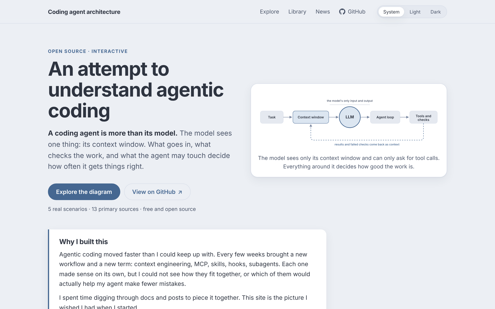

# Coding agent architecture

**An attempt to understand agentic coding: an interactive map of how a coding agent works, and how a real task moves through it.**

A coding agent is more than its model. The model sees one thing, its context window. What goes in, what checks the
work, and what the agent may touch decide how often it gets things right. This project draws all of it in one place,
so you can see where each new term fits, and give your agents what they need to do better work, with fewer defects.

New names for this work keep appearing. The site is organised around the loop itself, which changes far more slowly
than the vocabulary.



## What's inside

| Page | What it does |
|---|---|
| **Home** (`#/`) | The big picture in one screen, why I built it, the three things that decide how well an agent works, and where each term fits. |
| **Explore** (`#/explore`) | The interactive diagram. Walk five real scenarios step by step, click any box for what it does and a source, and move, resize and reroute anything. |
| **Library** (`#/library`) | The primary sources behind the diagram, and a glossary that places every term in the loop. |
| **News** (`#/news`) | A curated feed of agentic coding news. Under construction. |

Link to any box with `#/explore?focus=<id>`, for example `#/explore?focus=lp_hooks`.

## Run it locally

You need Node.js 18 or later.

```bash
git clone https://github.com/YOUR-GITHUB-USER/agenticcodingblog.git
cd agenticcodingblog
npm install
npm run dev
```

Then open the address Vite prints, usually `http://localhost:5173`.

| Command | What it does |
|---|---|
| `npm run dev` | Starts the dev server with live reload. |
| `npm run check` | Validates every data file and reports the first problem it finds. |
| `npm run build` | Runs the check, builds into `dist/`, and writes `404.html` for client-side routing. |
| `npm run preview` | Serves the built site locally. |

## Deploy

The site is static (no server), so any static host works. It is set up for the custom domain
**agenticcoding.blog**, served from the root.

### Cloudflare Pages (recommended)

Connect the repo and use:

- **Build command:** `npm run build`
- **Build output directory:** `dist`
- **Environment variable:** `NODE_VERSION` = `20`

Full walkthrough, including the custom domain and DNS, is in [docs/DEPLOY.md](docs/DEPLOY.md).

### GitHub Pages (alternative)

A workflow at `.github/workflows/deploy.yml` checks, builds and publishes on every push to
`main`. One-time setup: **Settings -> Pages -> Source: GitHub Actions**. The build emits a
`CNAME` file, so the custom domain is kept across deploys.

### Custom domain

The repo already contains `public/CNAME` with `agenticcoding.blog`, copied into every build.
At your DNS provider, point the domain at your host:

- **Cloudflare Pages:** add the domain in the project's **Custom domains** tab; if your DNS is on
  Cloudflare it is wired automatically, otherwise add the `CNAME` record they show you.
- **GitHub Pages:** add an `A`/`AAAA` record set to GitHub's Pages IPs (or a `CNAME` to
  `<user>.github.io`), then set the domain under **Settings -> Pages**.

Because the site is served from the root, `vite.config.js` sets `base: "/"`. For a GitHub Pages
*project* page instead (`https://OWNER.github.io/REPO/`), change it to `base: "/REPO/"`.

## How it's built

React and [React Flow](https://reactflow.dev) for the canvas, [ELK](https://eclipse.dev/elk/) for automatic layout,
and Vite for the build. There is no backend: everything is static.

```
src/
  data/          the content: boxes, lines, scenarios, sources, glossary, site settings
    validate.js  checks every reference; shared by the app and `npm run check`
  pages/         the home, library and news pages
  site/          routing, theme, header and footer
  App.jsx        the explorer
  layout.js      automatic layout with ELK
scripts/
  check-data.mjs validates the data from the command line
```

Everything you see comes from the JSON files in `src/data/`. Changing the diagram, adding a scenario or adding a source
means editing data, not code. [`src/data/README.md`](src/data/README.md) describes every field.

## Contributing

Contributions are welcome: a new scenario, a correction, a better example, or a primary source. Read
[CONTRIBUTING.md](CONTRIBUTING.md) for how to make each kind of change and what makes a good one.

## License

[MIT](LICENSE). Use it, adapt it, and share it.

The sources in the Library belong to their authors; this project links to them and does not copy their content.
